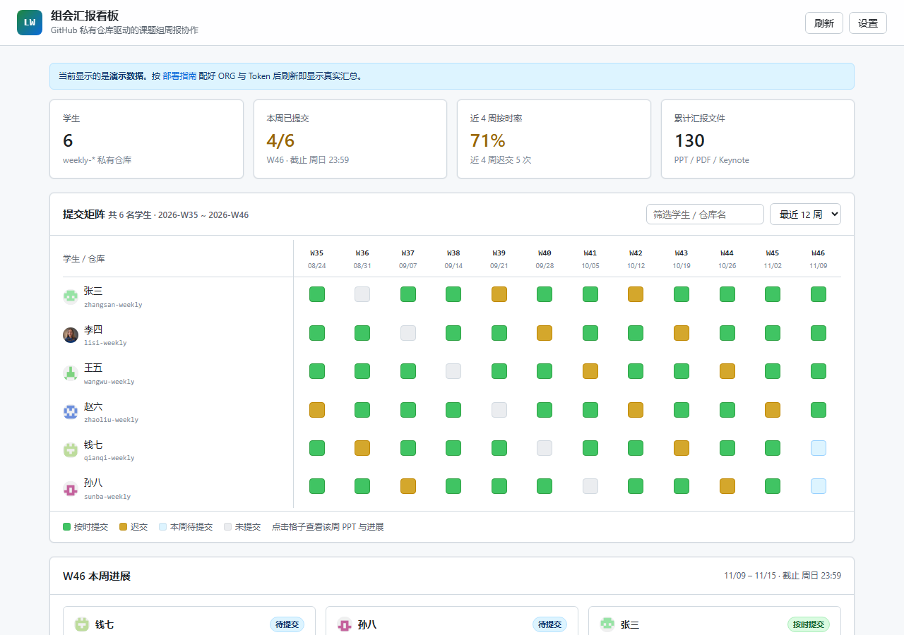

# 组会汇报看板 · Lab Weekly

一个**零服务器**的课题组周报 / 组会 PPT 协作系统，完全跑在 GitHub 上：

- 每个学生一个**私有仓库**，每周把 PPT + 进展 push 进去（网页上传也行，不用装 git）
- 老师打开一个**公网网页**，一屏看到所有人每周是否提交、是否迟交，点开即看 PPT
- 汇总由 **GitHub Actions** 定时生成，页面由 **GitHub Pages** 托管，不需要买服务器、不需要域名

```
学生私有仓库 weekly-zhangsan ─┐
学生私有仓库 weekly-lisi     ─┼─► GitHub Actions（每周一 09:00 汇总）
学生私有仓库 weekly-wangwu   ─┘        │
                                    data/summary.json
                                           │
                                    GitHub Pages（公网看板）
                                           │
                          老师：矩阵看进度 → 点开看 PPT / 打开私有仓库
```

## 功能

| 能力 | 说明 |
|---|---|
| 提交矩阵 | 学生 × 周次，绿=按时、黄=迟交、灰蓝=本周待提交、灰=缺失，一眼看出谁掉队 |
| 本周进展卡片 | 每人一张卡：状态、文件、提交时间、README 里的进展摘要 |
| PPT 内容预览 | 在页面里直接抽出每页文字（浏览器本地解析 pptx，不依赖第三方服务） |
| 直达私有仓库 | 点「在 GitHub 打开」用你自己已登录的 GitHub 账号看原件，权限沿用 GitHub |
| 迟交判定 | 默认周日 23:59，可切成「周一组会前」或不判定 |
| 学生端零门槛 | 网页拖拽上传即可，仓库自带检查工作流，目录写错会提示 |

## 三步上线（约 20 分钟，全在 GitHub 网页上点）

1. **学生建仓库**：`weekly-<拼音>` 私有仓库，内容照 `student-template/` 抄
2. **老师建看板**：把本仓库 push 到你自己的 GitHub（public 即可），在 `Settings → Secrets and variables → Actions` 里加
   - 变量 `ORG` = 组织名（如 `lab-weekly`）
   - 变量 `REPO_PREFIX` = `weekly-`
   - 密钥 `ORG_READ_TOKEN` = 一个有 Contents 只读权限的 fine-grained token
3. **开 Pages**：`Settings → Pages → Source = GitHub Actions`，手动跑一次 `汇总并发布看板`

详细步骤见 **[docs/部署指南.md](docs/部署指南.md)**，选型对比见 **[docs/调研报告.md](docs/调研报告.md)**。

## 界面



## 本地预览与测试

```bash
npm install          # 只装测试/预览用的开发依赖（jsdom、jszip）
npm run serve        # http://127.0.0.1:8765/
# 打开 http://127.0.0.1:8765/#demo 看演示数据

npm test             # 4 组测试：演示渲染 / 汇总脚本 / pptx 解析 / summary 渲染
```

`#demo` 里有 6 名学生 × 24 周的模拟数据，可以不配任何东西先感受交互。

## 目录结构

```
lab-weekly/
├── index.html              看板页面
├── css/style.css           GitHub 风格样式
├── js/app.js               数据加载 + 渲染
├── js/pptx.js              浏览器端 pptx 文本解析（JSZip）
├── js/demo.js              演示数据
├── scripts/collect.mjs     汇总脚本（Actions 里跑）
├── scripts/summary-to-step.mjs  Actions 运行摘要
├── .github/workflows/
│   └── collect-and-deploy.yml   定时汇总 + 发布 Pages
├── student-template/       发给学生的私有仓库模板（含目录检查工作流）
├── roster.example.json     学生名单示例（学生不在同一组织时用）
├── tests/                  本地测试（node --test 之外的轻量冒烟测试）
└── docs/
    ├── 调研报告.md          市面同类方案对比
    ├── 部署指南.md          从零上线步骤
    └── preview.png          界面截图
```

## 边界与取舍

- **看板仓库建议 public**：GitHub Free 只能从 public 仓库发布 Pages。因此 `data/summary.json` 里的内容（学生姓名脱敏后的仓库名、文件名、提交时间）是公开的。默认**不包含**提交说明和进展正文，需要开启时明确提示风险（`INCLUDE_PROGRESS=1`）。
- **PPT 原件不公开**：看板只存链接和状态，文件本身留在私有仓库，谁的权限能看还是 GitHub 说了算。
- **页面内预览私有 PPT** 需要一次 GitHub Token（可选，存在本机浏览器），不配也能用，只是要点「在 GitHub 打开」。
- 适合 5–50 人的课题组；再大建议上 GitHub Classroom 或自建后端。
